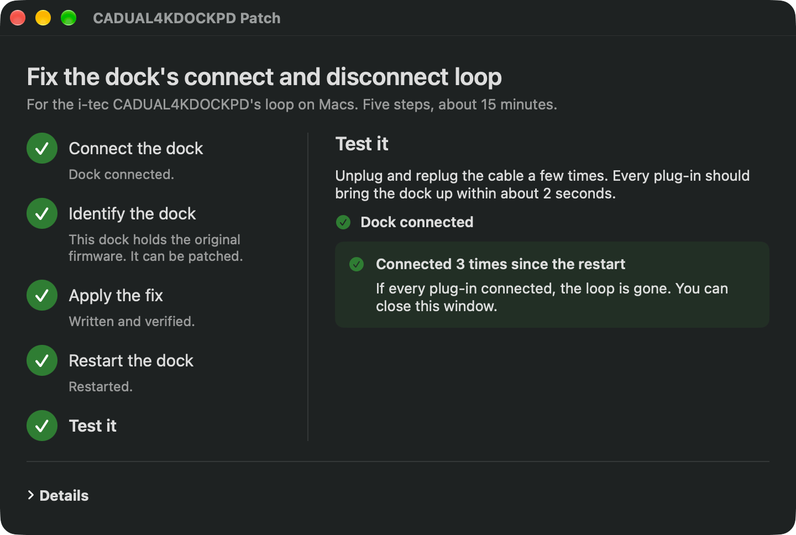

# i-tec CADUAL4KDOCKPD tools

An app that fixes the connect and disconnect loop of the i-tec CADUAL4KDOCKPD dock (USB-C, DisplayLink,
85 W power delivery) on Macs, and the investigation behind it. The app runs on macOS and on Windows.
Not affiliated with i-tec, Good Way, Texas Instruments, Genesys Logic or Cable Matters.

## The loop and the fix

- On an Apple silicon MacBook Pro the dock connected on about 13 of 39 fresh plug-ins. On the others it
  attached and detached about every 0.85 s without end, until the cable was replugged: no monitors, no
  USB, no charging.
- The outcome follows who becomes the power source first: when the dock is first, it works; when the Mac
  is first, it loops. Updating the dock's two USB hubs from firmware 93.05 to 93.92 did not change this.
- The cause is one setting, Try.SRC, in the dock's TI TPS65982 power controller. The app switches it
  off, over USB, through the dock's own management chip.
- With that one bit cleared, 20 of 20 plug-ins connected on the tested unit, on three Mac ports,
  including 7 that started with the Mac as the power source. An unpatched second unit looped on 5 of 7
  plug-ins on the same Mac the same evening.
- The measurements above come from one patched dock, one Mac, one cable, one day. Full account:
  [`dock-capture/REPORT.md`](dock-capture/REPORT.md).

## Before you use it

- **You can lose the dock.** The management chip can only write the power controller's flash after
  erasing the whole chip. If the dock loses its own power between the erase and the verified write (a
  few minutes), it will not start again without an external flash programmer. Use a dock you can afford
  to lose.
- The app refuses a dock whose flash content differs from the one it expects, and erases nothing before
  that check.
- **How far it has been tried.** As of 2026-11-27, five docks have been patched successfully. Nothing
  has written a dock from Windows yet: the Windows app has only been started on GitHub's machines,
  without a dock.
- Afterwards, charging depends on the computer accepting a power-role swap about half a second after
  plug-in. The test Mac always did.
- Texas Instruments' own update for this controller rewrites one of its two firmware copies at a time
  and would survive a power loss. It needs an interface that this dock does not give a Mac in normal
  use; [`PROTOCOL.md`](dock-capture/gw-updater/PROTOCOL.md), "What TI's documents add", has what is
  known and what is still to be tested.
- You do this at your own risk.

## Download

The [Releases](../../releases) page holds the app, built by GitHub from this repository:

- `CADUAL4KDOCKPD-Patch-macos.zip`: the Mac app, Apple silicon and Intel, macOS 14 or later. It is signed
  for local use only, so run `xattr -dr com.apple.quarantine "CADUAL4KDOCKPD Patch.app"` after unzipping it.
- `CADUAL4KDOCKPD-Patch-App.exe`: the Windows app, 64-bit Windows 10 or 11, nothing to install.

Neither contains any firmware. The app takes the power controller's image out of the updater that Cable
Matters publishes for a dock on the same platform: download `DUD15X0D1_Update_E108.exe` from
<https://kb.cablematters.com/index.php?View=entry&EntryID=129> into your Downloads folder, and do not
run it. The app finds it there, and links to that page when it does not.

## Use

1. Plug in the dock's power supply and open the app. Then connect the dock to the computer. On a Mac an
   unpatched dock connects on about one plug-in in three: replug until the app moves on.
2. **Identify the dock.** This only reads. It says whether the dock holds the firmware the app expects.
3. **Apply the fix.** Read the warning and type `ERASE`. The dock is checked, erased, written and checked
   again, which takes about 8 minutes. Until it says "Written and verified", leave the dock's power
   supply and the cable in. The app cannot be closed meanwhile.
4. **Restart the dock** as the app shows: cable out, power supply out for 15 seconds, power back in,
   cable in.
5. **Test it.** Unplug and replug the cable three times; the app counts the connections.

If the write could not be verified, do not unplug the dock's power: press **Write again**. The dock keeps
working from memory as long as it stays powered. To undo the change, choose **Dock > More options...**
and restore the original firmware. **Dock > Hub firmware 93.92...** is about i-tec's optional update for
the dock's two USB hubs: the Mac app can install it, the Windows app says how to do it with i-tec's own
program. It does not affect the loop.

The command line, what is checked before anything is erased, and how to build the apps:
[`cadual4kdockpd-patch/README.md`](cadual4kdockpd-patch/README.md).

## What else is here

| Path | Content |
|---|---|
| `cadual4kdockpd-firmware-update-macos-fwupdtool.md`, `update-cadual4kdockpd-firmware-macos.sh`, `test-update-cadual4kdockpd-firmware-macos.sh` | Updating the dock's Genesys hubs to 93.92 from macOS with `fwupdtool` |
| `displaylink-macos-performance-tuning.md` | DisplayLink settings and architecture notes |
| `dock-capture/REPORT.md` | The plug-in loop investigation: captures, tests, cause, the change and its result |
| `dock-capture/sampler.py`, `mark.sh`, `replugs.py` and the other scripts next to them | Mac-side capture (USB, power and port-controller state at 4 Hz) and its analysis |
| `dock-capture/gw-updater/PROTOCOL.md` | USB HID protocol of the dock's management chip (Good Way, `065f:f60f`), how the power controller's flash was read and written through it, and the run sheet |
| `dock-capture/gw-updater/GHIDRA.md` | How to load the firmware files into Ghidra |
| `dock-capture/gw-updater/tools/` | Read-only query tools, the TPS65982 image checker and patcher, the flash write tool and its offline rehearsal |
| `cadual4kdockpd-patch/` | The app and its command-line tool: a Rust engine with a SwiftUI window for macOS and a Win32 window for Windows. Its README has the command line, what is checked before anything is erased, the tests and how to build |

## Not in this repository

Firmware images, flash dumps, compiled tools, captures and logs are left out: they are vendor binaries
or contain device serial numbers. The notes refer to them by file name (for example
`itec-ti-flash-original.bin`); `PROTOCOL.md` describes how each one was obtained.
