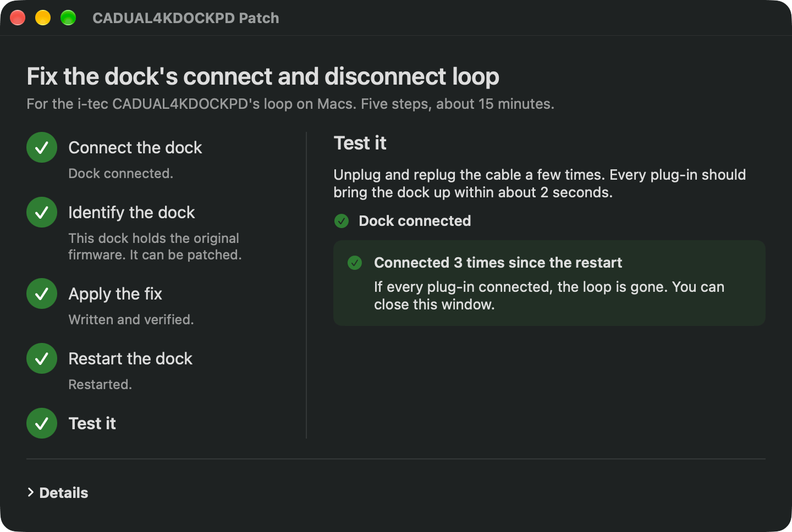

# cadual4kdockpd-patch

Switches Try.SRC off in the power controller of an i-tec CADUAL4KDOCKPD dock, over USB, from macOS or
Windows. Why that helps on Macs, and the evidence: [`../dock-capture/REPORT.md`](../dock-capture/REPORT.md).

## Read this first

- **You can lose the dock.** The dock's flash can only be written after erasing the whole chip. If the
  dock loses its own power between the erase and the verified write (a few minutes), it will not start
  again without an external flash programmer. Use a dock you can afford to lose. The controller has
  an update method of its own that would survive this, but the dock gives the computer no way to use
  it in normal use: see "What TI's documents add" in
  [`PROTOCOL.md`](../dock-capture/gw-updater/PROTOCOL.md).
- **Status of this tool.** The same sequence, sent by an earlier tool, patched one dock from macOS
  (2026-11-25). This Rust version sends byte-for-byte the same data frames and passes its tests against
  a model of the chip. Through the Mac app it patched a dock on 2026-11-27: written and verified on the
  first attempt, and after the restart the dock came back on 3 replugs. It has not yet written a dock
  from Windows: the Windows app is built and started on GitHub's Windows machines for every change (see
  Packaging), but has not been used with a dock.
- **What you gain and lose** is described in the report: the dock stops looping on Macs; charging then
  depends on the computer accepting a power-role swap about half a second after plug-in.
- You do this at your own risk. Not affiliated with i-tec, Good Way, Texas Instruments or Cable Matters.

## What you need

1. The dock on its own power supply. Connect only one such dock. Start the tool first and then plug
   the dock in: the tool waits for it. On a Mac an unpatched dock connects on about one plug-in in
   three, so replug until the tool continues. It cannot shorten this: while the dock loops there is no
   USB link to talk over.
2. The firmware updater that Cable Matters publishes for a dock on the same platform. This tool takes
   the power controller image out of it; no firmware is included here. Do not run that file.
   Page: <https://kb.cablematters.com/index.php?View=entry&EntryID=129>, file `DUD15X0D1_Update_E108.exe`
   (SHA-256 `1d5a9170def9e280716e9f116426fe3c312e0e42e83b3c55d790d6547816220b`). The app links to that
   page when it cannot find the file, and the command-line tool names it.
3. The app from the [Releases](../../../releases) page, or Rust to build the tool yourself:
   `cargo build --release`. The program is `target/release/cadual4kdockpd-patch`; Packaging has the apps.

## Use

There are three parts:

| Part | Where | What it does |
|---|---|---|
| Engine and command-line tool | `src/` (Rust) | Everything that touches the dock, and the step-by-step flow. `cadual4kdockpd-patch serve` is how a window drives it: commands in, JSON lines out (`src/serve.rs`) |
| macOS app | `macos/` (SwiftUI) | The window on a Mac. Draws the engine's state; contains no dock code |
| Windows app | `src/window.rs` (Win32, Rust) | The same window on Windows, built into the engine's own exe (`--features window`) |

The window leads through five numbered steps: connect the dock, identify it (read only), apply the fix,
restart the dock, test it. The engine watches for the dock, so the window knows when the dock is
connected, unplugged and back. Before anything is written the window shows what will happen and asks
you to type `ERASE`; the engine checks that word again. The log is a box of its own at the bottom. The
hub update and restoring the original firmware are out of the flow, in windows of their own opened from
the "Dock" menu. The app cannot be closed while a write is running.



The same from a terminal:

```sh
# read only: which image does the dock hold?
cadual4kdockpd-patch check DUD15X0D1_Update_E108.exe

# switch Try.SRC off (asks you to type ERASE before it changes anything)
cadual4kdockpd-patch patch DUD15X0D1_Update_E108.exe

# go back to the original image
cadual4kdockpd-patch restore DUD15X0D1_Update_E108.exe
```

After `WRITE VERIFIED`, restart the dock: unplug the USB-C cable from the computer, unplug the dock's
power supply for 15 seconds, then connect power first and the computer second.

If a run ends with `NOT VERIFIED`: do not unplug the dock's power. Run the same command again with
`--after-failed-write` added. The dock keeps working from memory as long as it stays powered.

## What it checks before it erases anything

- The updater file contains the expected image, and both images built from it have the expected
  SHA-256. These are exactly the bytes that were tested.
- The dock's management chip (USB `065F:F60F`) reports firmware E103, the only version tested.
- The flash is idle and not write-protected.
- The dock holds exactly the expected image: the chip's checksum over the whole image and over every
  4 KB prefix must match. A dock with any other firmware is refused.

Then it erases, writes 3,295 frames (about a minute), and verifies the result the same way. The
sequence and the reasons for each step are in [`../dock-capture/gw-updater/PROTOCOL.md`](../dock-capture/gw-updater/PROTOCOL.md).

## Hub firmware (optional)

The dock has two Genesys GL3523 USB hubs. i-tec publishes firmware 93.92 for them ("FW Patch, for
selected systems only", `Patch_CADUAL4KDOCKPD.rar`). It does not affect the loop on Macs.

```sh
cadual4kdockpd-patch hubs check  DIR     # read only: which hub is which, and its version
cadual4kdockpd-patch hubs update DIR     # asks you to type UPDATE
```

`DIR` holds `Hub_1_9392_L1.ROM` and `Hub_1_9392_L2.ROM` from that patch (`../update-cadual4kdockpd-firmware-macos.sh`
unpacks them). The Mac app has the same two actions.

This part works on macOS. On Windows a program can reach a USB hub only through a kernel driver;
i-tec's own updater in that patch, `CADUAL4KDOCKPD_9392.exe`, installs one and is the tool to use there.

On macOS the tool reads each hub's firmware header to tell
the first hub from the second, refuses anything it does not recognise, erases only the image's sectors,
writes, reads back, and restarts the hub.

**Status:** this hub update has not yet updated a real hub. It sends the requests that fwupd's genesys
plugin sends, in the same order, and fwupd is what updated the first dock's hubs. It passes its tests
against a model of the hub and recognises real dumps of both hubs. If it fails part way, run it again;
`fwupdtool` (see the repository's hub guide) and i-tec's own patch remain as alternatives.

## Tests

```sh
cargo test                                  # the write sequence against a model of the chip, and the window's flow
DOCK_UPDATER=/path/to/DUD15X0D1_Update_E108.exe cargo test -- --ignored   # image rebuild from the real file
```

## Packaging

- **macOS app:** `packaging/bundle-macos.sh` builds `target/bundle/CADUAL4KDOCKPD Patch.app` for Apple silicon
  and Intel (macOS 14 or later; building needs Xcode), with an icon drawn at build time. The window and
  the engine both sit in `Contents/MacOS`. It is signed for local use only, not notarized: on another
  Mac, run `xattr -dr com.apple.quarantine "CADUAL4KDOCKPD Patch.app"` before opening it. `SIGN_IDENTITY`
  signs it with a certificate of yours instead (see the script); other Macs accept that without the
  step above only for a Developer ID certificate plus Apple's notarization.
  `.github/workflows/macos-app.yml` at the top of the repository does the same on GitHub, starts the app
  as a test and keeps it, zipped, as the artifact of the run. Publishing a release there attaches that
  zip to it as `CADUAL4KDOCKPD-Patch-macos.zip`.
- **Windows app:** one exe, built on Windows with Rust:

  ```sh
  cargo build --release --features window
  ```

  `target\release\cadual4kdockpd-patch.exe` is the whole app, about 1 MB: started without arguments it
  opens the window (plain Win32 controls) and runs itself a second time as the engine, `serve`. It needs
  nothing installed on 64-bit Windows 10 or 11 and can be renamed. The feature makes it a GUI program, so
  for the command line use the build without it. `.github/workflows/windows-app.yml` at the top of the
  repository builds it on GitHub as `CADUAL4KDOCKPD-Patch-App.exe`, starts it as a test and keeps it as the
  artifact of the run. Publishing a release there attaches that exe to it.
- **Windows from a Mac:** `cargo build --release --target x86_64-pc-windows-gnu` (needs `mingw-w64`)
  gives `cadual4kdockpd-patch.exe`, the command-line tool on its own. With `--features window` it is the
  app, but without its manifest (only the MSVC linker embeds it): old-style controls and blurry text on
  scaled screens, so use it only to try a change.

The engine looks for the image next to the program (or next to the `.app`), in the working folder and in
Downloads: first `tps65982-image-1.38.6.bin`, a file holding only the power controller image, then
`DUD15X0D1_Update_E108.exe`. Every command accepts either file.

**A build with the firmware inside.** For handing the tool to people who should not need any file:

```sh
export DOCK_IMAGE_FILE=/absolute/path/to/tps65982-image-1.38.6.bin
export DOCK_HUB_L1_FILE=/absolute/path/to/Hub_1_9392_L1.ROM
export DOCK_HUB_L2_FILE=/absolute/path/to/Hub_1_9392_L2.ROM
packaging/bundle-macos.sh
cargo build --release --target x86_64-pc-windows-gnu --features embedded-image   # the Windows engine
```

That program contains vendor firmware, so keep it internal. Each image is still checked against its
SHA-256 before use. This repository and a plain build contain no firmware.

The Windows exe gets its image differently, since it is built on GitHub where no firmware goes: attach
the image file to the end of the finished exe (`cat CADUAL4KDOCKPD-Patch-App.exe image.bin > "CADUAL4KDOCKPD Patch.exe"`).
The window names its own file to the engine (`DOCK_IMAGE_IN`), and the engine finds the image in it.
